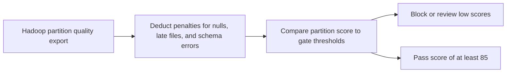

# Hadoop Data Quality Sentinel

A malformed or incomplete Hadoop partition can propagate defects into training and reporting. Reviewers need a gate before consuming it.

## What I built

I built a Hadoop partition review gate for exported quality metrics. It deducts penalties for null rate, late files, and schema errors, then maps scores below 70 to block, 70–84 to review, and 85 or higher to pass.

## How it works



[Architecture](docs/ARCHITECTURE.md) · [Decision rules and source](docs/RULES.md)

## Tools used

| Tool | Role in this repository |
| --- | --- |
| Python | [quality_sentinel.py](quality_sentinel.py) implements the CLI and decision rules. Uses `csv` to read tabular exports. |
| Make | Runs the documented example and the local `unittest` suite. |
| Python replay runner | Compares actual stdout with the checked-in baseline fixtures. |
| Ruff and Bandit | Developer lint and static security checks through `make check`. |

## Run the project

Use Python 3.10+ and Make. From the repository root:

```sh
python3 quality_sentinel.py sample_partitions.csv
```

The user_events sample passes at 96. App sessions is blocked at 6, and purchase events goes to review at 72. [Full expected output](examples/Demo%201.stdout.txt)

### Additional replay cases

- **Last sample record in isolation** · `python3 quality_sentinel.py examples/last-record.csv` · [Expected output](examples/Last%20sample%20record%20in%20isolation.stdout.txt)

## Verify the project

```sh
make verify
make replay
```

`make replay` checks the recorded cases and exits nonzero if the output changes.
See the [developer guide](docs/DEVELOPMENT.md) for the pinned lint and security tools.

## Operating limits

The utility reads a CSV export and does not inspect HDFS or Hive directly.

[Case study](docs/CASE_STUDY.md) · [Operator runbook](docs/RUNBOOK.md) · [Verification report](reports/verification.md)
