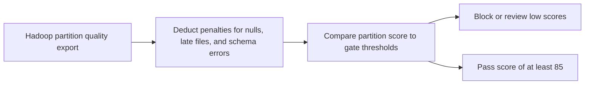

# Hadoop Data Quality Sentinel

Scores Hadoop table partitions before downstream ML pipelines consume them.

Focus: Hadoop, data quality, feature pipelines, SRE release gates.

Portfolio framing: Apple-scale client-style data platform project using synthetic data only.

## Run

```bash
python3 quality_sentinel.py sample_partitions.csv
```

## Verify

```bash
python3 -m unittest discover . -v
```

## Local verification

Run `make verify` with Make and Python 3 installed. The target runs the documented sample through the project CLI. It also runs the existing Python unit tests.

## Business problem

A malformed or incomplete Hadoop partition can propagate defects into training and reporting. Reviewers need a gate before consuming it.

## Project walkthrough



[Architecture and data flow](docs/ARCHITECTURE.md) · [Business problem, demo, and verification](docs/CASE_STUDY.md)
