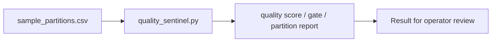

# Hadoop Data Quality Sentinel architecture

Scores Hadoop table partitions before downstream ML pipelines consume them.

## Operational boundaries

The documented run evaluates the bundled sample locally. Results depend on the quality and scope of the input. The demo makes no live infrastructure changes.
